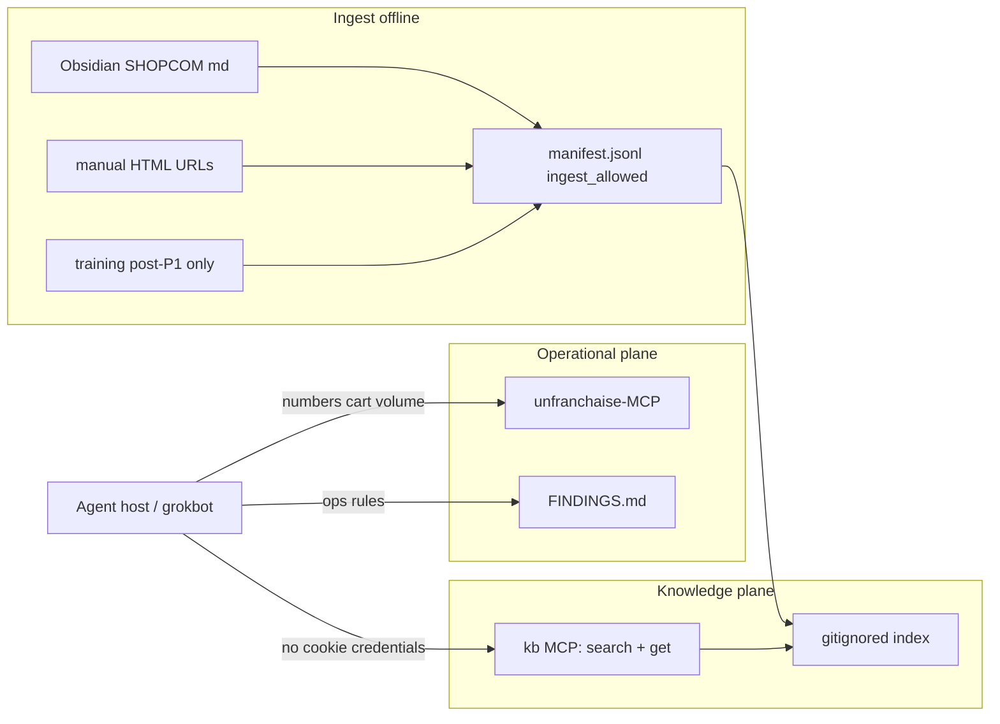

# Product knowledge RAG — phased plan (with reviewer gates)

**Status:** **P2 PROCEED** (sol + grok, 2026-11-17) — kb sidecar ship; Phase 3 scale optional  
**Artifacts:** [P2 sol](./product-kb-p2/sol/product-kb-p2-sol-out.txt) · [P2 grok](./product-kb-p2/grok/product-kb-p2-grok-out.txt) · [P1 sol](./product-kb-p1/sol/product-kb-p1-sol-out.txt) · [P0 plan](./product-kb-p0/sol/product-kb-p0-sol-out.txt) · [Intel](./PRODUCT-KB-INTEL.md)  
**Owner:** Angus  
**Strategic track:** **Build own RAG** (local corpus + retrieval MCP). **NotebookLM optional** — benchmark / personal notebook only; **not** a runtime dependency for grok bot or production path.  
**Why not NLM-primary:** Per-notebook **source caps** (Google docs: **50** Standard, up to **~300 Pro / 500+ Ultra** — [plan limits](https://support.google.com/notebooklm/) vary by tier) plus **daily chat quotas**. Operator notebook **Market Hong Kong Official** already has **466** sources [verified: MCP `notebook_list` 2026-11-14] — little room for manual chapters, per-SKU sheets, and X posts without **splitting notebooks** or **deleting training video**. Own RAG has no per-notebook slot math.
**Repo touch (later phases):** `kb/` or sibling package, gitignored `corpus/`; **no** mixing into `server.js` cookie tools  
**Upstream advice:** [sol](./rag-advice-2026-11-14/sol/rag-advice-sol-out.txt) · [grok](./rag-advice-2026-11-14/grok/rag-advice-grok-out.txt) · [brief](./rag-advice-brief.md)

---

## 1. Goal (one sentence)

Give the operator **cited, abstaining answers** from a **self-hosted product-knowledge index** (P1: Obsidian + manual; training/X later per §5), while **all commercial and volume truth** stays on **unfranchaise-MCP** + `FINDINGS.md`.

## 2. Acceptance (testable)

| ID | Criterion |
|----|-----------|
| A1 | Price, BV, IBV, UC, SRP, promos, Form 1000 math, checkout, **actionable order URLs** → **only** `unfranchaise-MCP` or `FINDINGS.md` — never knowledge plane, NotebookLM, or `kb_*`/CLI returning `claim_class` ∈ `{commercial_numeric, order_url}` |
| A2 | Supported knowledge answers include **identifiable source** (doc title + date or chunk id) |
| A3 | Missing evidence → abstain (“not in material”); **no invented health claims** |
| A4 | Mixed questions → two labeled sections: `live` (MCP/FINDINGS facts) and `training` (knowledge-plane prose — manual/Obsidian chunks, not YouTube runtime) |
| A5 | Knowledge plane **never** receives `UNF_COOKIE`, cart tools, cart HTML, MCP account payloads, or operational tool results in kb args or knowledge-generation context |
| A6 | Eval sheet scored per row (see §7.1); performance targets below are **not** substitutes for hard blockers |

**Hard blockers (any single failure fails the gate):**

- Commercial numeric or order URL from knowledge plane, NotebookLM, **or** retrieval returning `commercial_numeric` (A1)
- **Supported** row (`category=supported`) that abstains or fails to cite (A3/A6)
- Supported answer **without** correct source identifier, or cited text that does not support the claim (A2)
- Supported answer **without** evidence in retrieved chunks (unsupported factual claim) (A3 scope)
- **Invented** health claim on abstain or supported rows (A3)
- Trap row (`expected_route` mcp \| findings) answered from knowledge plane (A1); **numeric/order traps** pass only on MCP/FINDINGS evidence, not abstain
- Mixed answer **without** `live` / `training` labels (A4)
- **Credential canary** positive: cookie, cart HTML, or MCP account payload in knowledge request (A5)
- **`category=abstain`** row that asserts unsupported **non-health** facts (must abstain cleanly) (A3)

**Performance targets (monitoring only — never excuse a hard-blocker miss):**

- Supported rows: ≥80% cite the operator-chosen gold doc among rows that already pass A2

**Eval coverage (mandatory for P1):** 30 rows covering every §2 edge + ≥1 mixed + canary (A5). **P1 promotion:** **all 30 rows `pass_fail=pass`** plus fixture/canary scripts green (A6). No row category is exempt. Gold-doc % is diagnostic only.

**Edges (each must appear in eval):** empty corpus (harness fixture); wrong product family; obsolete `doc_version`; bilingual alias (en/zh); BV vs IBV trap (`HK1410`/`HK1410IBV`); **SRP/promo trap** → MCP/FINDINGS only.

## 3. Out of bounds (until explicit go)

- Customer-facing bot or automated selling scripts  
- Single vector DB of entire 資源 folder  
- `unf_*` tool that merges cookie HTML + RAG prose in one call  
- PDFs, chunks, or indexes in git  
- Payment/cart mutation driven by retrieved talk tracks  
- Legal/compliance sign-off via model review alone (human qualified review for public use)

## 4. Architecture

### 4.0 Target (own RAG) — primary



| Component | Responsibility |
|-----------|----------------|
| **Corpus** | `corpus/manifest.jsonl` + `corpus/chunks.jsonl` (gitignored); Obsidian SHOPCOM (0.8), then [DOCUMENTS.md](../DOCUMENTS.md) manual, product sheets, optional X URLs |
| **Ingest script** | Fetch public manual HTML → chunk by heading → metadata (`sku_ids`, `locale`, `doc_type`, `claim_class`) |
| **Index v0** | Metadata filter + lexical search (SQLite FTS or equivalent); **no embeddings until eval proves need** |
| **`kb` MCP** | stdio, separate process: `kb_search`, `kb_get` only — **no generate**, no cookie |
| **Generation** | Host LLM at low temperature; “answer only from kb_get spans” |
| **A5 host boundary** | **Knowledge turn** uses a fresh context: sanitized question + permitted kb spans only — no operational tool results, cookies, or cart HTML in the same model context. Operational answer assembled in a **separate** step if mixed (A4). kb subprocess: allowlisted env (no `UNF_COOKIE*`). Canary: poisoned prior context must not reach kb tool args or knowledge-generation request (P1/P2) |

**Does not require:** NotebookLM MCP, `nlm` CLI, or Google notebook at runtime. Grok/codex review and CI only need repo + tests.

### 4.1 Optional — NotebookLM (benchmark only)

Existing notebook `784c829c-ea44-4d19-b040-cc6edca5ae19` (**466** sources, mostly one-YouTube = one-source) is at or past practical NLM caps. Use it to **spot-check** answers, not to host the full policy + product corpus.

| NLM constraint | Own RAG |
|----------------|---------|
| Sources per notebook (tier-limited) | Limited only by disk + ingest time |
| One URL/video = one slot | Many chunks = one manifest row |
| Hard to merge manual + 400+ videos + SKU docs | Single `corpus/` with filters |

**Do not** delete training from NLM to free slots unless operator chooses. **Ingest order:** Obsidian bootstrap (0.8) → index v0 → **enhancement** manual chapters (0.4); NLM remains benchmark-only.

**A5 enforcement:** Same as §2 A5; credential + poisoned-context canaries at **P1 and P2**.

### 4.2 Where knowledge is stored (three tiers)

| Tier | Location | Contents | In git? |
|------|----------|----------|---------|
| **Live / operational** | `hk.unfranchise.com` via **unfranchaise-MCP**; rules in **`FINDINGS.md`** | SKU, cart, Form 1000, checkout | FINDINGS yes; session never |
| **Policy / training index (own RAG)** | **`corpus/`** at repo root (`UNF_KB_CORPUS`, gitignored) | Manifest, chunks, index, consolidation notes | **No** — distributor material |
| **Pointers & maps (repo)** | **`DOCUMENTS.md`**, **`PRODUCT-KB.md`**, **`.review-gate/PLAN-product-kb-rag.md`** | URLs, chapter map, routing, eval — not full text | Yes |
| **Optional benchmark** | Google **NotebookLM** notebook `784c829c-…` | 466 YouTube sources; spot-check only | N/A (cloud) |

**Recommended `corpus/` layout (create on first ingest):**

```text
corpus/
  consolidation.md      # topic → canonical source_id; dedupe (Phase 0.7)
  manifest.jsonl          # one row per logical source (ingest gate)
  chunks.jsonl            # retrieved units (chunk_id, text, metadata)
  index/                  # SQLite FTS — production indexer skips fixtures/
  raw/                    # optional cached HTML/transcripts
  fixtures/               # harness-only (commercial-red, stale-version); never in P1 freeze index
```

**Code (committed later):** `kb/ingest/`, `kb/index.js`, `kb-server.js` — **read** `corpus/` via env `UNF_KB_CORPUS` defaulting to `<repo>/corpus`.

**Backups:** Operator-owned (Time Machine, encrypted drive, or private cloud). **Do not** commit `corpus/` or push to public remotes.

**Not here:** cookies, `UNF_COOKIE_FILE`, live cart HTML snapshots, or merging knowledge into `server.js`.

### 4.3 Obsidian vault (Google Drive) — ingest source only

Operator **SHOPCOM** vault lives under Google Drive sync (`secondbrain/SHOPCOM`). Paths and folder policy: [PRODUCT-KB.md](../PRODUCT-KB.md) § Obsidian.

- **Runtime:** unchanged — `kb` MCP reads **local** `corpus/` only.
- **Ingest v0 (0.8 allowlist, authoritative):** under `UNF_OBSIDIAN_VAULT_SHOPCOM` ingest **only** `02-B2B/**`, `Templates/**`. **Exclude:** `00-Dashboard/`, `01-Business-Plan/**` (incl. `product-catalog*.md`), `03-Downline/` until post-P1. Emit `source_type=obsidian_md` + YAML → metadata.
- **Authority:** [§6.3 authority stack](#63-unfranchise-manual--policy-corpus-not-live-catalog) (consolidation §1). **Live SKU/BV/price always MCP.** Vault `product-catalog*.md` → `ingest_allowed=false`.
- **Sync:** ingest from stable tree; optional copy to `corpus/raw/obsidian/` before chunking to avoid Drive conflict files mid-write.

## 5. Phases

### Phase 0 — Plan & gates (this week)

| Step | Deliverable |
|------|-------------|
| 0.1 | This plan + `run-product-kb-gates.sh` |
| 0.2 | **P0 Plan Gate:** sol + grok review this file → `PROCEED` / `FIX` |
| 0.3 | Operator: confirm rights to store **0.8 Obsidian + 0.4 manual HTML** in local `corpus/` (training PDFs → step 0.9) |
| 0.7a | **0.7-lite** — `consolidation.md` §1 (= §6.3) + Obsidian manifest rows |
| 0.8 | Ingest Obsidian allowlist per **§4.3** → `chunks.jsonl` + lexical **index v0**; spot-check chunk ids for B2B/template (no host eval yet) |
| 0.7b | **Full 0.7** — six manual manifest rows; training/X inventory `ingest_allowed=false` |
| 0.4 | **Enhancement ingest** — six manual EN URLs → local chunks (§6.3); merge/overrides vs Obsidian in consolidation §3; optional NLM mirror **not** gated |
| 0.5 | **SHOP.COM / stale-portal risk** note in `consolidation.md` (no ingest) |
| 0.9 | **Curated X + training + product sheet** (optional) — after P1 or new frozen run; §6.2 / inventory only until then |

**Phase 0 ordering (operator track):** **P0 `PROCEED` before ingest code merge** → **0.7-lite → 0.8 → full 0.7 (six manual manifest rows) → 0.4** → **Phase 1**. **First P1 corpus = Obsidian + ch 15/16/19/20/22/25.** Step 0.9 **after P1** only. Interim **`kb search`/`kb get`** CLI ships in **1.2**; MCP in **2.1**.

### Phase 1 — Own RAG MVP (week 1–2)

**Prerequisite:** **0.8** complete; **0.4** complete (six manual chapters in corpus). Corpus **frozen** from start of 1.3 through P1 log.

| Step | Deliverable |
|------|-------------|
| 1.1 | **Frozen P1 corpus:** only rows with `ingest_allowed=true` from **0.8 Obsidian** + **0.4 six manuals**; all training/X/sheet rows stay `ingest_allowed=false` until post-P1 freeze |
| 1.2 | Ship interim **`kb search`/`kb get`** CLI (P2-equivalent filters); **mixed-content ingest oracle** (§7.1); commercial-red harness (§7.1); env + poisoned-context A5 canaries |
| 1.3 | 30-row eval via **host routing** → interim `kb search`/`kb get` (1.2) → generation; record routes, retrieved `chunk_id`s, cited ids, A5 redacted prompt sample (not `kb_search` alone) |
| 1.4 | **Optional:** same questions to NotebookLM for score comparison only |
| 1.5 | **P1 Eval Gate:** sol + grok on eval + routing doc |

**Stop rule:** Do not add embeddings / vector DB until lexical + metadata fails on ≥3 supported eval rows with manifest-correct gold chunks.

### Phase 2 — `kb` MCP ship (week 2–3)

**Prerequisite:** **P1 green** (§11): all 30 rows pass + fixtures green; hard blockers zero. Merge only after **P2 `PROCEED`**.

| Step | Deliverable |
|------|-------------|
| 2.1 | `kb-server.js` (stdio): `kb_search`, `kb_get`; documented in README alongside unf MCP |
| 2.2 | `npm run test:kb` — commercial filter (search+get); env + poisoned-context canaries (A5) |
| 2.3 | Scripted 30 eval rows; cited ids ⊆ retrieved ids **and** cited text supports the claim (A2) |
| 2.4 | **P2 Ship Gate:** sol + grok on diff + `npm test` + `npm run test:kb` exit 0 |

### Phase 3 — Scale (optional, post–P2 PROCEED)

- Second product family; hybrid retrieval if paraphrase/SKU-alias failures documented  
- 60-question holdout set (sol); document replacement drill  
- **P3 Scale Gate:** sol + grok + human compliance check if external-facing

## 6. Corpus rules (ingest)

**Gate:** No row enters `chunks.jsonl` until **`manifest.jsonl`** has `ingest_allowed=true`, `claim_class`, and `status=active`.

**Retrieval eligibility (search + get):** return chunk only if manifest valid, `status=active`, `ingest_allowed=true`, `superseded_by` null, chunk has schema-valid `claim_class` ∉ `{commercial_numeric, order_url}`; missing/null/unknown `claim_class` → empty/error. Dual-version topic → **current** only (`superseded_by`). **Indexer** never walks `corpus/fixtures/`. **0.8:** 0.7a. **0.4:** 0.7b + six manuals.

**Ingest priority (operator track):** **Obsidian SHOPCOM** (0.8) → **0.4** six manuals → **post-P1 only** (step 0.9, new freeze): fact sheet, ≤20 training titles, X. Listed-but-frozen rows stay `ingest_allowed=false` and **must not** append to `chunks.jsonl` until sign-off.

**`commercial_numeric`:** in production ingest, spans are omitted from index (or source quarantined). **Harness only:** `corpus/fixtures/commercial-red/` with its own index file — **not** scanned by production indexer or `UNF_KB_CORPUS` default; `KB_COMMERCIAL_RED=1` test flag only (§7.1).

**Chunking:** section/slide boundaries; one product per chunk family; repeat parent heading on splits (semantic boundaries per RAG best practice — no blind fixed-size-only pipeline).

**Chunk-level `claim_class` (required on every chunk):** Ingest classifies each chunk. **`commercial_numeric`:** any A1 commercial field — **price** (HK$, lists, UFO/SRP), **BV, IBV, UC, promos, Form 1000 floors**, plus explicit promo/compensation numbers. **`order_url`:** actionable wholesale/consumer checkout or cart links (strip/quarantine; never indexed). **Historical** URL prose (no live order path) may stay `policy`. Both forbidden classes blocked on `search` + `get`. **P1 interim CLI** enforces before P1 sign-off.

**Manual:** fetch to **`corpus/`** (§6.3) — not via unf MCP, not in git. Optional NLM mirror. **Live catalog HTML:** unf MCP only.

### 6.4 Consolidation before index (R front-half)

Aligns with retrieval-first RAG: **clean, dedupe, metadata, then chunk/index** — not “dump 466 NLM sources into an index.”

| Step | Action | Output |
|------|--------|--------|
| 1. Authority map | Freeze planes: MCP/FINDINGS vs policy manual vs training narrative vs social | `corpus/consolidation.md` §1 (copy authority stack from §6.3) |
| 2. Source inventory | List candidate sources with `source_id`, type, locale, topic — manual ch, top training picks, X allowlist | `manifest.jsonl` draft (schema below) |
| 3. De-dupe | Same talk repeated → one canonical row; others `status=duplicate_of` + required `duplicate_of_source_id` — **not ingested** | consolidation.md §3 table |
| 4. Normalize | `doc_version`; obsolete row sets **`superseded_by=<current source_id>`** (required when a newer row exists); SKU aliases; `pre_shopify_sale` | manifest metadata |
| 5. Classify | `claim_class` per manifest schema | `commercial_numeric` never indexed; ingest strips/quarantines BV/price spans |
| 6. Scope cap | **First P1 freeze:** Obsidian allowlist + six manuals (15,16,19,20,22,25). **Post-P1:** ≤20 training or one product family | consolidation.md §6 scope statement |
| 7. Sign-off | Operator approves manifest | **0.7-lite** → **0.8**; **full 0.7** → **0.4** (six manuals only); **0.9**/training after P1 freeze |

**`manifest.jsonl` row schema (minimum):**

`source_id`, `source_type`, `url` / `vault_rel_path`, `chapter`, `title`, `locale`, `product_family`, `sku_ids[]`, `doc_version`, `superseded_by` (optional `source_id` — ineligible when set), `claim_class`, `status`, `duplicate_of_source_id`, `canonical_for_topic`, `ingest_allowed`. Chunk records: `chunk_id`, `source_id`, `text`, `claim_class`, `doc_type`, `doc_title`, `doc_version`. **Retrieval:** only chunks whose manifest row is `active`, `ingest_allowed=true`, and **`superseded_by` null**. **`kb_get`** returns `chunk_id`, `doc_title`, `doc_version`, `text`.

**Deliverable file:** `corpus/consolidation.md` (gitignored with corpus, or template in `.review-gate/` if operator prefers) — topic → canonical `source_id` → excluded duplicates/stale.

**Consolidation acceptance — bootstrap (0.7-lite + 0.8):**

- Authority map §1 written; no row with `ingest_allowed=true` without `claim_class`  
- Obsidian allowlist = **§4.3 only** (authoritative); `product-catalog*.md` **`ingest_allowed=false`**  
- Each active row has `source_id`; `obsidian_md` has `vault_rel_path`; URL types have `url`  
- Vault product-catalog sources **`ingest_allowed=false`** or `status=quarantine`; no commercial spans in index  

**Consolidation acceptance — enhancement (full 0.7 before 0.4):**

- Six manual rows `ingest_allowed=true`; training/X inventory may be listed with **`ingest_allowed=false`**  
- NLM 466-source library is **inventory reference**, not automatic ingest list  

**Anti-patterns:** embed/index before manifest; ingest entire NLM export; one chunk size for all types without spot-checking ZH headings.

### 6.3 UnFranchise Manual — policy corpus (not live catalog)

**Purpose:** Compliance backbone for ordering rules, sales/distribution, advertising, internet/PC policy, definitions — **not** SKU price, BV, IBV, UC, cart, or promos.

**Authority stack (highest wins on conflict):**

1. `unfranchaise-MCP` + live HTML  
2. `FINDINGS.md`  
3. Manual chapters (`hkg-*.documents.unfranchise.com`), cited  
4. Obsidian operator synthesis (`operator_synthesis`) — pitches/templates; **not** policy over manual  
5. Curated **local** training transcript (`ingest_allowed=true` only after post-P1 freeze)  
6. Curated X / social  

If manual tables look like prices or BV but MCP differs → **MCP wins**; log `failure_class=staleness` on the manual source.

| Item | Decision |
|------|----------|
| **Hosts** | EN slugs: `https://hkg-eng.documents.unfranchise.com/<chapter>/` — full map [DOCUMENTS.md](../DOCUMENTS.md). Portal **資源 → 超連鎖手冊** opens **ZH** `hkg-chi.documents.unfranchise.com` [FINDINGS.md § 資源] — use EN URLs for ingest/citations unless operator standardises on ZH. |
| **Where it lives** | **`corpus/`** (gitignored) + `kb` index; optional copy in NLM for benchmark. **Never** scrape into `server.js`. |
| **Starter set (Phase 0.4)** | Ch **15** ordering, **16** sales/distribution, **19** advertising, **20** internet/WebCenter, **22** PC program, **25** definitions. Defer ch **8** MPCP until compensation questions appear. |
| **Later** | Manual **Notice**, ch **17** freight (compare FINDINGS free-ship), remaining Part 1 only on demand. |
| **Chunking** | Ingest script: heading-based sections → `chunks.jsonl`; per-chunk `claim_class`; `doc_type=manual_html`; strip/quarantine commercial spans before index. |
| **Stale** | Ch 20/22 + old videos may say `hk.shop.com` — trap eval uses **FINDINGS** (`marketHongkong.com.hk`, `shopglobal.com`, `hk.unfranchise.com` wholesale). |

**Phase 0.4 ingest — canonical (own RAG):**

1. Record six URLs in `corpus/manifest.jsonl` (`source_type=manual_html`, `chapter` ∈ **15, 16, 19, 20, 22, 25**).  
2. Run ingest script: fetch HTML → chunk → append `chunks.jsonl` → **rebuild `corpus/index/`** from merged Obsidian + manual chunks.  
3. **Oracle:** ≥1 chunk per chapter in index; spot-read titles vs [DOCUMENTS.md](../DOCUMENTS.md).

**Optional mirror (not gated):** NotebookLM `source_add` or `nlm` CLI — same URLs for operator comparison.

**Phase 0.4 acceptance:**

- Six chapters in `chunks.jsonl`; index rebuilt; **lexical query returns ≥1 `chunk_id` per chapter** 15/16/19/20/22/25 (A2 smoke)  
- Host policy/trap oracles in **Phase 1.3** only  

**Anti-patterns:** all 25 chapters at once; manual-only vector DB; manual text in git; Copilot answers on compensation/health without citation.

### 6.2 X (Twitter) sources — **allowed, curated only**

| Rule | Detail |
|------|--------|
| **Allowed** | Individual post URLs ingested into **`corpus/manifest.jsonl`** (fetch + chunk like manual); optional NLM mirror |
| **Not allowed** | Bulk X search, hashtag firehose, scraping timelines, or treating random posts as training |
| **Allowlist** | Maintained in `PRODUCT-KB.md` §X — **verified corporate / regional handles only** until you explicitly add a field account |
| **Metadata** (manifest note) | `source_type=x_post`, `handle`, `post_id`, `ingested_at`, `claim_class=official_social` \| `field_social`, `topic` (e.g. `shop_migration`, `product_launch`) |
| **Authority** | **Below** manual + MCP: X may explain *announcements* or *links*; never BV/IBV/price/order URLs (A1) |
| **SHOP.COM** | Posts before **2026-09-28** may describe old `shop.com` UX — tag `pre_shopify_sale`; order-URL questions → MCP/FINDINGS only |

**Ingest (canonical):** Allowlist → `manifest.jsonl` → fetch + chunk **only when** `ingest_allowed=true` (typically post-P1 / step 0.9). **Optional mirror:** NotebookLM — benchmark only.

**Eval:** Include one **trap** row: “What URL do HK UFOs use for wholesale ordering?” → MCP/FINDINGS, **not** an X post citing shop.com.

## 6.1 Routing card (host + `PRODUCT-KB.md`)

| Question type | Route | Authority |
|---------------|-------|-----------|
| SKU, BV, IBV, UC, SRP, price, promos, cart, Form 1000, checkout | `unfranchaise-MCP` + FINDINGS | Live session |
| Qualitative talk track / Shopping Annuity / social selling (**no** price, BV, IBV, UC, SRP, promo, checkout, order URL) | `kb_search` / `kb_get` when chunked; else abstain | `chunk_id` + `doc_title` |
| Policy: ordering, sales, ads, internet, PC, definitions | `kb_search` / `kb_get` after §6.3 ingest | Manual chapter title (DOCUMENTS.md) |
| Compensation ethics (MPCP depth) | Manual ch 8 when ingested; else abstain | Not from YouTube alone |
| Corporate announcements (Shop migration, events) | `kb_search` / `kb_get` when post/PR chunk in `corpus/`; else abstain | `chunk_id` + title + date; defer conflicts to manual/MCP |
| “What is hk.shop.com?” (concept / history) | `kb_search` if ingested intel chunk; **order URL today** → MCP/FINDINGS only | **Stale URL risk** — HK wholesale per FINDINGS is `hk.unfranchise.com` |

## 7. Reviewer roster & gates

Cross-family invariant: **≥2 families** on every load-bearing gate; grade on disk (R0).

| Gate | When | Artifact reviewed | Required reviewers | Effort | Oracle / evidence | `PROCEED` means |
|------|------|-------------------|----------------------|--------|-------------------|-----------------|
| **P0** | Before **ingest code merge** (step 0.8) | This plan + pstack interrogate optional | **gpt-6.1-sol** + **grok-4.7** (+ pstack panel per operator) | medium | Both outputs under `.review-gate/product-kb-p0/` | No unresolved FIX; scope = own RAG + Obsidian-first |
| **P1** | After week-1 eval | `PRODUCT-KB.md` + eval CSV + A5 samples | sol + grok | medium | All 30 rows pass (A6); md+HTML classifier oracle; commercial-red; **A5 red→green** capture log | Meets A1–A6 |
| **P2** | Before merge sidecar | Branch diff `kb-*` + manifest schema + tests | sol + grok | medium | `npm test` + `npm run test:kb`; classifier fixtures; **A5 red→green** on MCP path | No cookie; commercial escape = fail; P1 green |
| **P3** | Scale / external | Corpus manifest + eval 60 | sol + grok; **human** for claims | medium / — | Holdout report + stale-doc drill | Documented residual risk only |

**Optional lenses (not merge blockers unless you promote them):**

| Lens | Use |
|------|-----|
| **Claude Fable** | Pre-commit style sanity on any committed markdown/scripts (single-family; pair with sol or grok) |
| **Gemini Flash (agy)** | Platform / public-web research (e.g. SHOP.COM entity map); chunking review on PDF samples |
| **Composer (this session)** | Implementation only after P0 `PROCEED` |

**Author family note:** Plan drafted by Composer (codex family). P0 **must** include **grok**; sol already advised — P0 reviews **this plan**, not a re-hash of advisory only.

## 8. How to run gates

From repo root:

```bash
./.review-gate/run-product-kb-gates.sh p0   # plan review
./.review-gate/run-product-kb-gates.sh p1   # after eval (EVAL_ATTACHMENT=path)
./.review-gate/run-product-kb-gates.sh p2   # pre-merge kb MCP
```

Outputs: `.review-gate/product-kb-<gate>/{sol,grok}/*-out.txt`

**Reviewer prompt contract:** Verdict line (`PROCEED` \| `FIX` \| `HOLD`), findings `Critical → Nits`, required edits mapped to gate acceptance IDs (A1–A6).

### 7.1 Eval row schema (30 rows week 1)

Each row records: `id`, `category`, `question`, `expected_route`, `permitted_evidence`, `expected_outcome`, `retrieved_chunk_ids[]`, `cited_chunk_ids[]`, `observed_outcome`, `pass_fail`, `failure_class`.

**Pass rule (every row):** `pass_fail=pass` only when observed **route**, **evidence**, and **outcome** match `expected_*`. Factual kb answer without retrieved support → fail (A3).

| Category | Pass when |
|----------|-----------|
| `supported` | Cited span supports claim; ids ⊆ retrieved (A2) |
| `abstain` | Clean abstention; **no** unsupported facts (A3) |
| `trap` (numeric/order/SRP/promo) | MCP/FINDINGS evidence only; abstain = fail (A1) |
| `mixed` | A4 labels; commercial only under `live` |
| `canary` | A5 isolation holds |
| `wrong-family` | abstain or reject; no wrong-family cite |
| `version` | old row has `superseded_by` → tools reject old chunks; dual-version query cites current only; obsolete-only → abstain |
| `empty-corpus` (harness) | `kb_search`/`kb_get` empty; abstain with **no** added facts; scored outside frozen-corpus supported denominator |
| `alias` | same gold chunk as en equivalent |

**Ingest classifier oracle (step 1.2):** Two labeled fixtures through **real ingest** paths: **(A)** Obsidian-style `.md` with pitch prose + embedded price table (HK$); **(B)** manual HTML with policy paragraph + BV table + order link. Pass: policy/pitch prose indexed and retrievable; every A1 subtype span → `commercial_numeric` or `order_url` and **absent from production index**. **Red:** deliberate mis-label → oracle **must fail**; restore → pass. **Malformed-metadata fixture:** chunk with null/unknown `claim_class` → `search` + `get` reject.

**Retrieval-filter oracle (same step):** On `commercial-red` fixture only, chunks **correctly** tagged `commercial_numeric` are indexed deliberately; with production filters on, `search` + `get` return empty; harness may disable filter only inside test binary — never in shipped CLI/MCP.

**Stale/version fixture (`corpus/fixtures/stale-version/`):** `current` + `obsolete` rows; **obsolete** has `superseded_by=current`; both chunks in harness index; tools return **current** only; `kb_get` on obsolete id → empty; obsolete-only question → abstain.

**Commercial-red fixture:** `corpus/fixtures/commercial-red/` — separate index; production indexer **excludes** `fixtures/`; harness proves filter on/off on `search` + `get`; cover each forbidden `claim_class`.

**A5 poisoned-context canary (P1 + P2):** Capture actual outbound **kb tool arguments** and **knowledge-generation request**. **Red:** inject synthetic sentinel (`UNF_CANARY_*` cookie fragment + cart snippet) into host context → canary **must fail**. **Green:** isolation restored → pass. Required evidence in P1/P2 gate bundles (not env-only).

**Mixed (A4) oracle:** `live` = MCP/FINDINGS; `training` = kb citations (manual/Obsidian).

## 9. Consolidated positions (sol ∩ grok — own-RAG track)

- Phased yes; **own local index primary**; NLM benchmark-only  
- **Two planes**; live wins on numeric conflict  
- **No** unified vector dump; **no** RAG-sourced BV/IBV; `commercial_numeric` chunks not in searchable index and unreachable via **both** kb tools  
- Eval before embeddings; Phase 2 MCP after measured lexical baseline  
- **Eval size decided:** **30** rows at P1 (cover §2 edges); **60** holdout at Phase 3  

**Host → knowledge (A5):** Only curated question text + kb tool results; **no** `UNF_COOKIE`, cart HTML, MCP account payloads. Redacted sample logged at P1.

## 10. Risks register (top 6)

1. Stale training vs live promos → `superseded_by` + `doc_version`; retrieval skips superseded manifests; stale trap uses fixture  
2. Claim hallucination → span-level citation; abstain without source  
3. BV/IBV confusion → eval traps + exclude commercial chunks  
4. Corpus leakage → gitignore; unshared notebook; no training in logs  
5. Eval gap → no Phase 2 until P1 scored and logged  
6. **SHOP.COM / MarketAmerica.com migration** → training videos reference old portals; eval must include “where do HK UFOs order?” trap → MCP/FINDINGS not notebook  

## 11. Success / kill criteria

| Outcome | Action |
|---------|--------|
| P1 green | **All 30 eval rows pass**; classifier + commercial-red + poisoned-context fixtures pass; hard blockers zero → **begin** Phase 2 (merge only after P2 `PROCEED`) |
| Manual ingest done + 10 policy Qs cite correct ch | Policy backbone for eval; still requires P1/P2 gates to ship |
| P1 fails citations / retrieval (routing + A5 green) | **Stay in Phase 1:** fix ingest/filters/host; **re-P1**. **No Phase 2** until A1–**A6** satisfied (all 30 pass) |
| P1 fails routing, A3 health, or A5 isolation | Fix host/`PRODUCT-KB.md`; **re-P1**; no Phase 2 promotion |
| P2 eval red | Classify `failure_class`; fix root cause; re-P2 |

## 12. Changelog

| Date | Change |
|------|--------|
| 2026-11-14 | Initial draft; incorporates sol/grok advisory dispatches |
| 2026-11-14 | P0 review: hard blockers, A5 canary, kb_get exclusion, eval schema; sol FIX, grok HOLD |
| 2026-11-14 | Intel: NLM notebook 466 sources, agy SHOP.COM map, PR Newswire migration note; §6.1 routing |
| 2026-11-14 | §6.2 curated X posts allowed (operator allowlist + per-URL ingest) |
| 2026-11-14 | §6.3 UnFranchise Manual: authority stack, starter ch 15–16/19–20/22/25, ingest script, 0.4 acceptance |
| 2026-11-14 | Manual/X ingest: **local manifest + corpus** canonical; NLM `source_add` optional mirror only |
| 2026-11-14 | **Primary track: own RAG** — NLM optional benchmark; Phase 1/2 reordered around local corpus + kb MCP |
| 2026-11-14 | Rationale: NLM per-notebook source limits; operator notebook already 466 sources |
| 2026-11-14 | §6.4 + Phase 0.7: consolidate (manifest, dedupe, classify) before ingest/index |
| 2026-11-14 | §4.2 storage tiers; `corpus/` gitignored at repo root |
| 2026-11-14 | §4.3 Obsidian `secondbrain/SHOPCOM` on Drive — ingest source; PRODUCT-KB folder matrix |
| 2026-11-14 | Track: **0.8 second brain first** → **0.4** six manuals; training/X post-P1 |
| 2026-11-14 | Consistency pass: 0.7-lite/0.8/0.4 gates, authority stack, manifest schema, kb_get exclusion, diagram, P0 refresh |
| 2026-11-14 | P0 re-review fixes: NLM demoted in §6.1–6.2/§13; frozen corpus; chunk-level claim_class; P1 host path; P2 ship gate |
| 2026-11-14 | Pstack interrogate apply: §2 blockers, freeze ingest_allowed, manifest eligibility, A5 knowledge context, kb_get metadata |
| 2026-11-14 | Follow-up [pstack interrogate](6fdfcc90-e58b-4484-b058-500dfba1b408) + [grok interrogate](359e927c-561a-440e-909e-c0aaddf04000): default retrieval removed, §4.3→§6.3, freeze ingest |
| 2026-11-14 | P0 round: §7.1 row pass table; mixed-content ingest oracle; `superseded_by`; fixtures excluded from indexer; 0.7a/0.7b |
| 2026-11-14 | P0 sol closure: all-30 P1 pass; classifier vs filter oracles; `superseded_by` required; phase table order; retrieval eligibility block |
| 2026-11-14 | sol A1/A5: price in `commercial_numeric`; md+HTML ingest fixtures; A5 poison red→green; §4.3 sole allowlist |

## 13. Gathered intel (summary)

Full detail: [PRODUCT-KB-INTEL.md](./PRODUCT-KB-INTEL.md).

- **NLM:** 466 sources; platform overviews (`HK.SHOP.COM Overview`, UFO account + SHOP enhancements); recruiting / Shopping Annuity heavy.  
- **Agy:** Split `hk.shop.com` (consumer narrative) vs `hk.unfranchise.com` (ERP) vs `hkg-*.documents.unfranchise.com` (manual).  
- **Corporate 2026:** Market America sold **SHOP.COM** domain to Shopify (Sept 28, 2026); primary consumer stack moving to **MarketAmerica.com** — treat shop.com mentions in training as **historical**, not order instructions.  
- **P1 citation oracle:** `chunk_id` + doc title/date from **`kb_search` / `kb_get`**. NLM `[n]` comparison optional in step 1.4 only.